# Лабораторная работа № 1 — «Свой Docker»

> В отчете сгенерированы только красивые подписи к картинкам и их центровки. Весь смысл и структуру автор донес сам своей головой просидев не один час за этой увлекательной работой.

На самом деле пришлось накатить ВМ линукса для этой лабы потому что старый ноут не хотелось доставать из каморки

## Содержание

1. [Сервис и обычный запуск](#часть-0)
2. [Namespaces](#часть-2)
3. [Cgroups](#часть-3)
4. [Права](#часть-4)
5. [Свой Docker](#часть-5)
6. [Образы](#часть-6)
7. [gVisor](#часть-7)
8. [Мониторинг](#часть-8)
9. [Вывод](#вывод)

---

# Часть 0

Я сгенерировал сервис на языке го с тестами к нему. Ничего особенно выдающегося в нем не нашел

- `GET /health` возвращает `ok`;
- `GET /eat?mb=N` выделяет и удерживает N мегабайт памяти;
- `GET /burn` нагружает одно ядро CPU.

---

# Часть 1

Тут самая простая часть, запустил ручками бинарник и протестил его работоспособность

Запустил, проверил `/health`

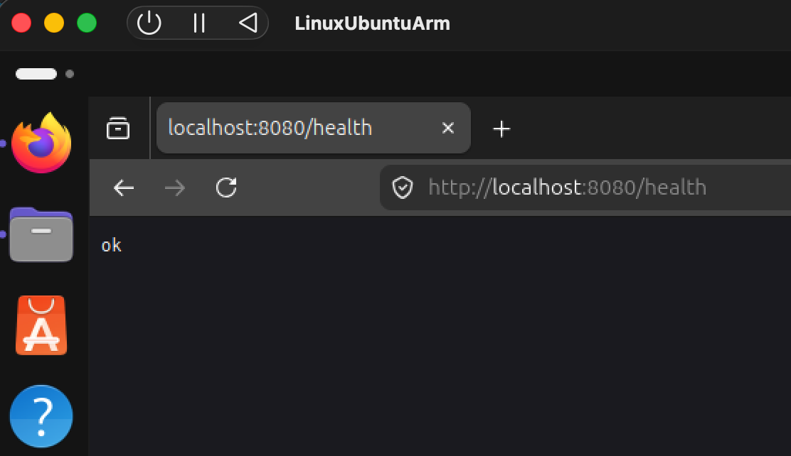

<em>Рисунок 1 — сервис отвечает <code>ok</code> на запрос <code>/health</code></em>

Затем полез в консоль для проверки `PID` процесса итоговый результат на скриншоте снизу. Хоть и многоуважаемый написал его при запуске перепроверил через ps

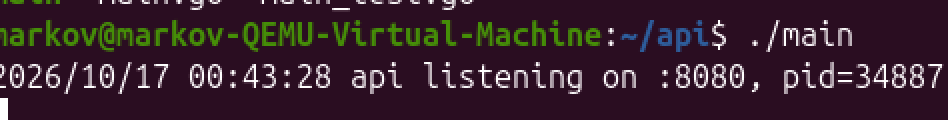

<em>Рисунок 2 — при обычном запуске сервис получил PID 34887</em>

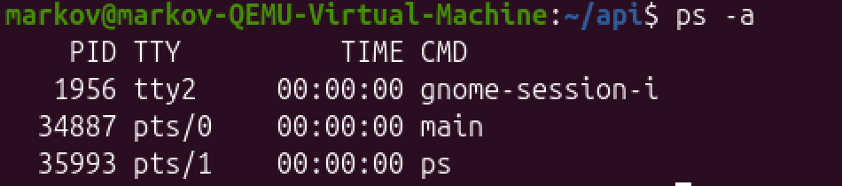

<em>Рисунок 3 — тот же процесс виден на хосте через <code>ps</code></em>

Изоляции не наблюдается, все у всех на виду.

---

# Часть 2

Переходим к уже более интересным вещам. Тут нужно было поместить процесс в namespaces

Запускаем процесс через unshare чтобы изолировать процесс и поместить его в отдельный namespace

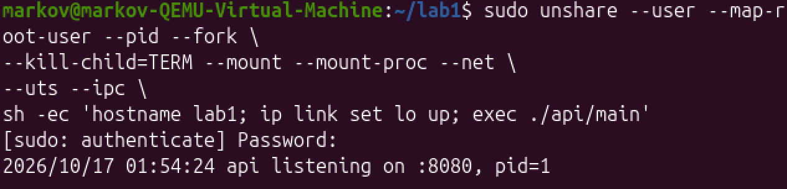

<em>Рисунок 4 — запуск сервиса в отдельных namespaces, внутри он получил PID 1</em>

Проверим то что все у нас получилось и мы молодцы

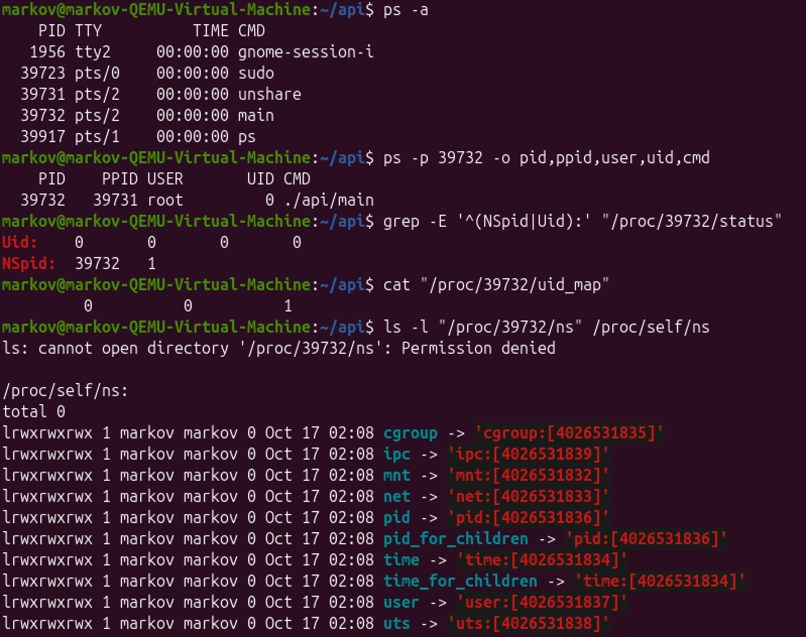

<em>Рисунок 5 — снаружи процесс имеет PID 39732, а внутри PID namespace — PID 1</em>

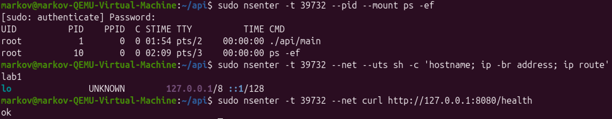

<em>Рисунок 6 — внутри видны только свои процессы, hostname равен <code>lab1</code>, а из интерфейсов есть только loopback</em>

Одна проблема - команда запущена через `sudo`, поэтому UID 0 внутри отображается в UID 0 снаружи. 

---

# Часть 3

Здесь надо было ограничить потребляемые ресурсы с помощью настройки cgroups. Ограничил память, cpu, количество процессов. Спойлер - с первого раза добиться нужного результата не получилось.

Создал cgroupv2, добавил туда процесс и задал три лимита: 64 МБ памяти, половину ядра и 32 процесса.

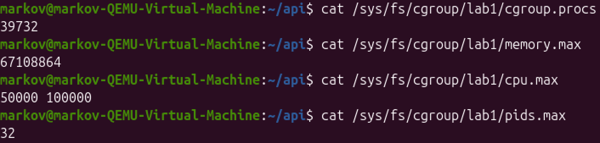

<em>Рисунок 7 — PID процесса и значения <code>memory.max</code>, <code>cpu.max</code> и <code>pids.max</code></em>

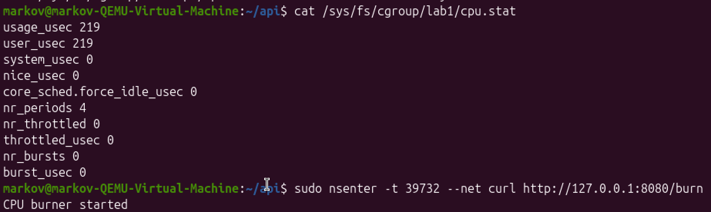

<em>Рисунок 8 — до запуска нагрузки throttling отсутствует</em>

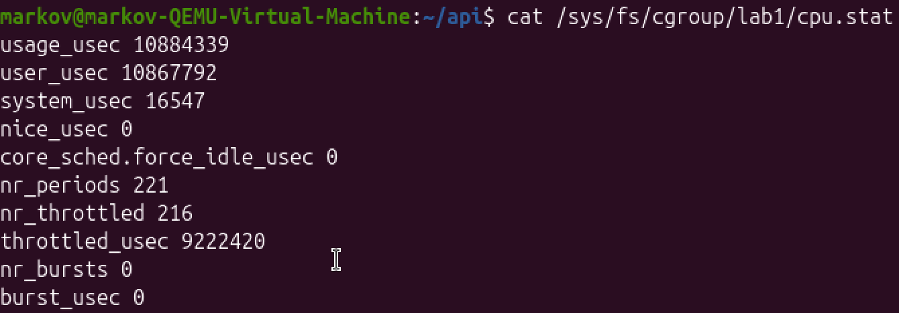

<em>Рисунок 9 — после нагрузки 216 из 221 периодов были throttled, лимит в половину ядра работает</em>

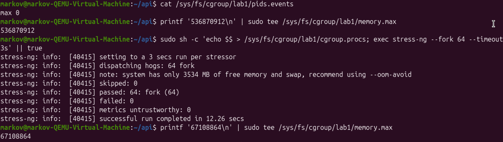

<em>Рисунок 10 — попытка запустить 64 fork-воркера при лимите 32 процесса</em>

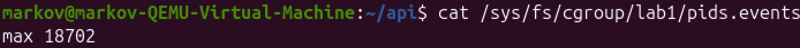

<em>Рисунок 11 — <code>pids.events:max</code> вырос до 18702: cgroup запрещала создавать лишние процессы</em>

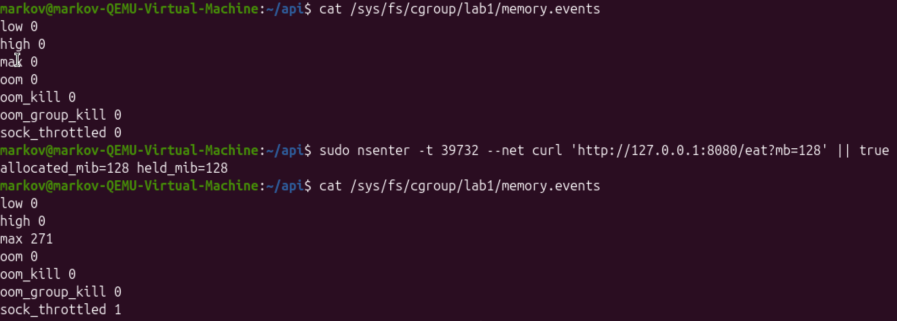

<em>Рисунок 12 — память упёрлась в лимит, но процесс пережил запрос и OOM kill не произошёл</em>

Вот тут то и ошибка. Программа отработала!!!! ТАК БЫТЬ НЕ ДОЛЖНО, вроде память ограничили, а OOM не видать(((

Лезем проверять что не так и куда наши добрые мегабайты могли уйти

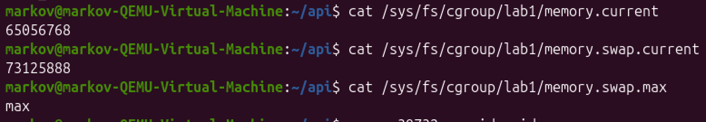

<em>Рисунок 13 — cgroup заняла около 65 МБ RAM и 73 МБ swap, а <code>memory.swap.max</code> был равен <code>max</code></em>

Ага, лишнее ушло в своп чтобы не положить все. Ну тогда уберем его, чтобы глаза не мозолил, а то еще помогает нам когда мы в память не влезаем

Заодно перезапустим процесс

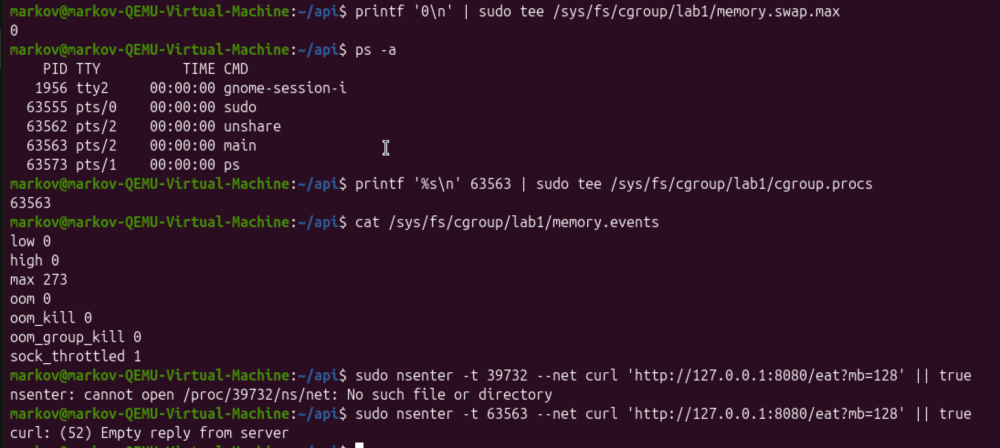

<em>Рисунок 14 — swap запрещён, а запрос 128 МиБ заканчивается пустым ответом из-за убийства процесса</em>

Ура, все получилось и мы убили наш процесс

---

# Часть 4

Убираем все capabilities

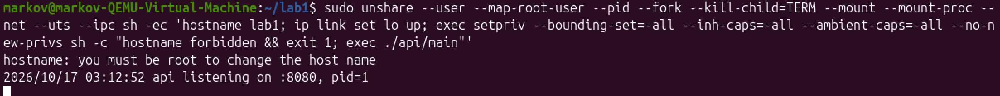

<em>Рисунок 15 — попытка изменить hostname завершается ошибкой <code>Operation not permitted</code></em>

И проверяем

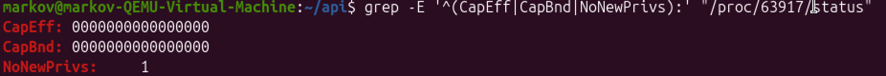

<em>Рисунок 16 — эффективный и bounding-наборы пустые, <code>NoNewPrivs</code> включён</em>

С помощью `capabilities` можно ограничить права поотдельности. Сбросим их все, чтобы процесс вообще не был никак priveleged. `NoNewPrivs` запрещает получить новые привилегии.

Теперь навесим `seccomp` фильтр

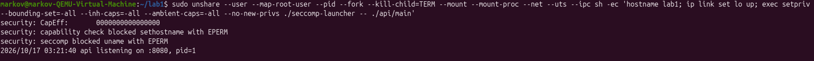

<em>Рисунок 17 — фильтр установлен, тестовый системный вызов <code>uname</code> получает <code>EPERM</code></em>

Проверим что он навесился

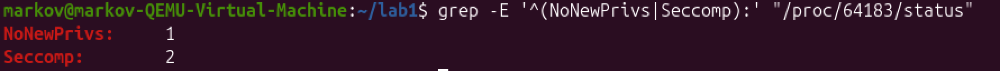

<em>Рисунок 18 — <code>Seccomp: 2</code> подтверждает режим фильтрации системных вызовов</em>

`Seccomp` фильтрует сами системные вызовы. Получается что он ограничивает доступ к ядру, а капабилитес к тому же и права режут чтобы совсем жизнь медом не казалась.

---

# Часть 5

Соединил все в один скрипт, смысла много говорить нет - все тоже самое что и выше

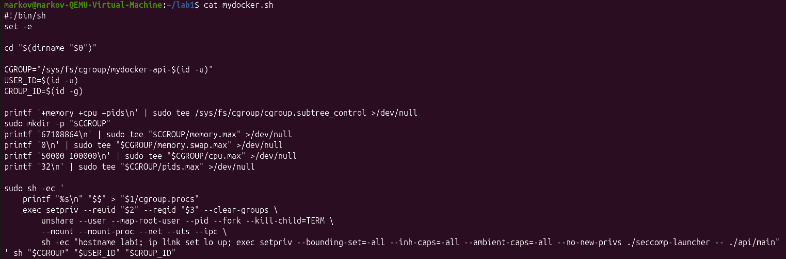

<em>Рисунок 19 — <code>mydocker.sh</code> создаёт cgroup, namespaces и запускает сервис с урезанными правами</em>

Сам скрипт лежит в [`mydocker.sh`](mydocker.sh).

Теперь запустим через докер

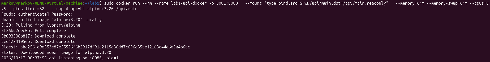

<em>Рисунок 20 — бинарник запущен через <code>docker run</code> с теми же основными лимитами</em>

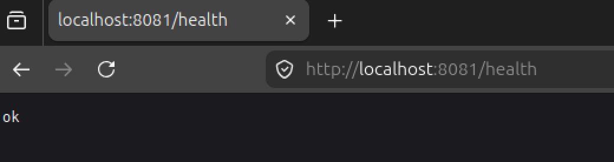

<em>Рисунок 21 — проброс порта работает, сервис отвечает на <code>localhost:8081/health</code></em>

и проверим ограничения

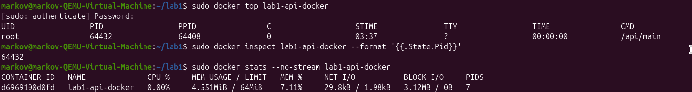

<em>Рисунок 22 — Docker показывает процесс на хосте и лимит памяти 64 МиБ</em>

По сравнению с докером у моего скрипта нет файловой системы, меньше доступа к сети и `seccomp` фильтр настроен собственноручно. В общем в докере есть всего побольше и получше в общем за что их и любят. Не зря ребята не только сделали то, что раньше делали руками, но еще и улучшили это для рядовых пользователей

---

# Часть 6

Сделаем свой докерфайл и используем `scratch`, проверим что все запускается

Для сравнения собрал промежуточный builder, обычный минимальный образ на `Alpine` и финальный образ на `scratch`.

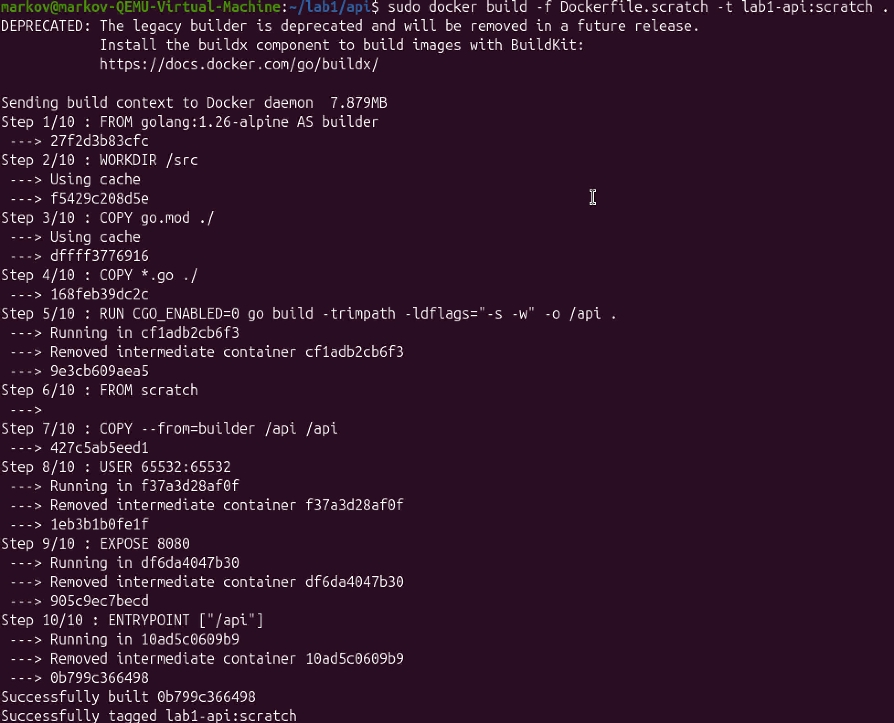

<em>Рисунок 23 — первая multi-stage-сборка образа на <code>scratch</code></em>

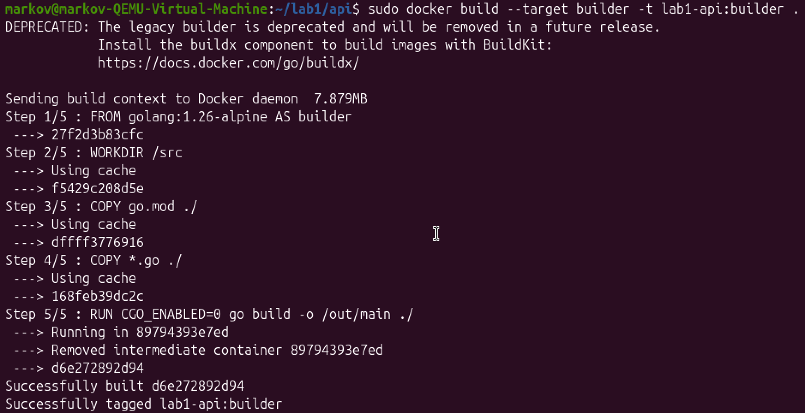

<em>Рисунок 24 — отдельная сборка стадии builder</em>

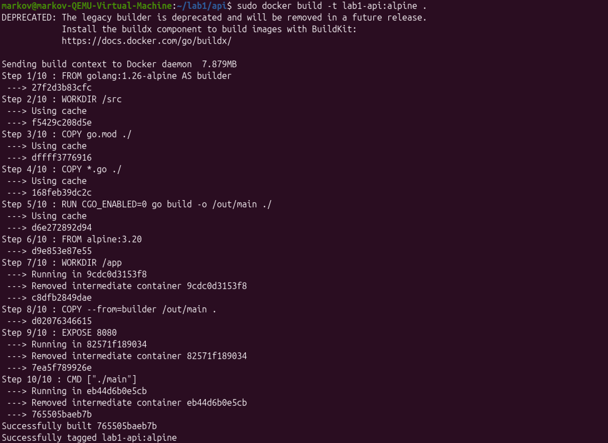

<em>Рисунок 25 — сборка финального образа с Alpine</em>

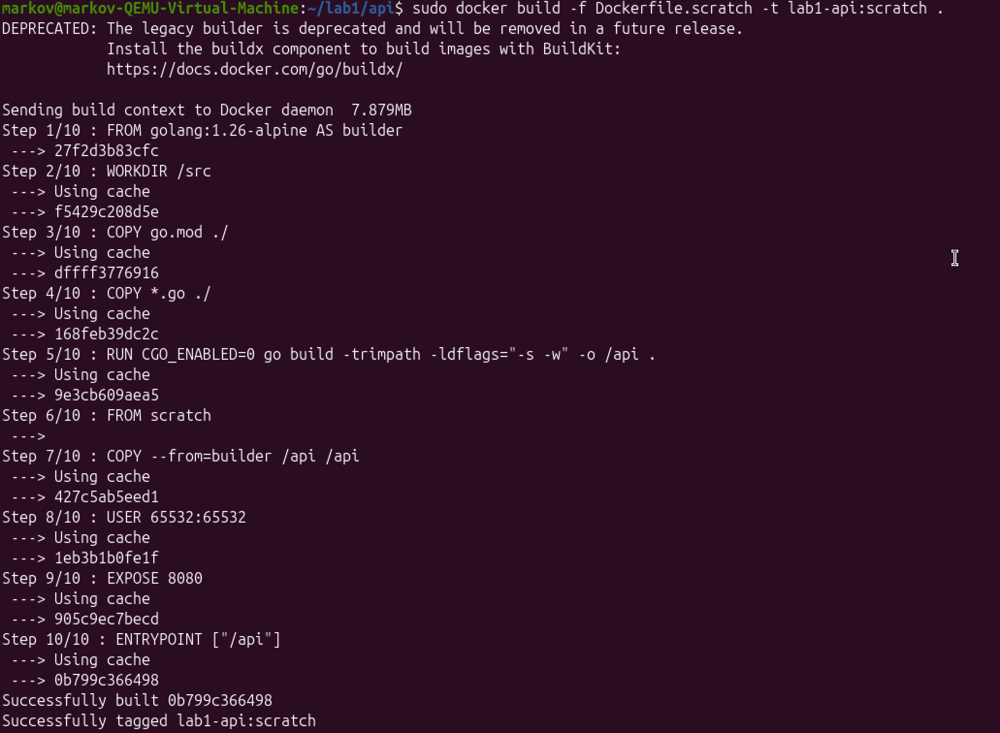

<em>Рисунок 26 — при повторной сборке неизменившиеся шаги взялись из кэша</em>

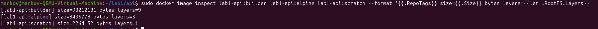

<em>Рисунок 27 — сравнение размеров и количества слоёв</em>

| Образ | Размер | Слоёв |
|---|---:|---:|
| `lab1-api:builder` | 93 212 131 байт (~88,9 МиБ) | 9 |
| `lab1-api:alpine` | 8 405 778 байт (~8,0 МиБ) | 3 |
| `lab1-api:scratch` | 2 264 152 байта (~2,2 МиБ) | 1 |

Меньше всего `scratch`, потому что в последнем слое лежит статически собранный бинарник и по минимому остального. При повторе Docker использовал то что уже есть в кэше и не пересобирал все заново.

Проверим то что верхний слой в контейнере не персистентный и все что мы там понаделаем удалится. Решается созданием тома - хранилище в которое мы будем сохранять наши творения.

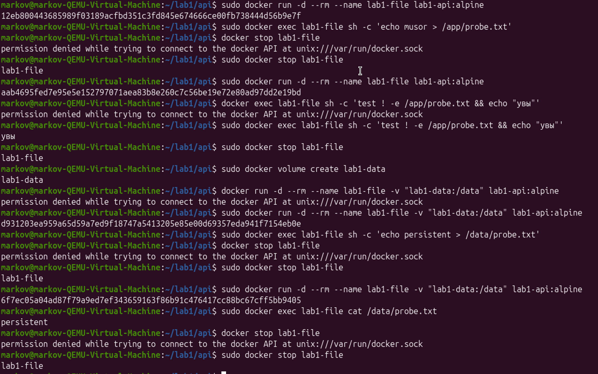

<em>Рисунок 28 — файл в writable-слое пропал после пересоздания контейнера, а файл в volume сохранился</em>

---

# Часть 7

Запустим наш контейнер через `gVisor`

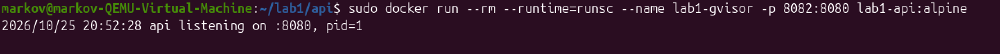

<em>Рисунок 29 — контейнер запущен с runtime <code>runsc</code></em>

<em>Рисунок 30 — <code>docker inspect</code> подтверждает использование <code>runsc</code></em>

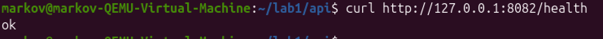

<em>Рисунок 31 — сервис под gVisor нормально отвечает на <code>/health</code></em>

По сути `gVisor` еще раз оборачивает наш контейнер чтобы системные вызовы которые идут к ядру нашей хост ОС шли туда по минимому с помощью виртуализации. Таким образом мы снижаем риски того что недобросовестные люди попытаются пролезть через контейнер на хост и натворить что им будет угодно.

---

# Часть 8

Для мониторинга собрал статистику из cgroup контейнера и сложил всё в csv. Каюсь тут сгенерировал красивый вывод данных для графиков в вебе. Есть графики памяти, CPU с throttling и количества процессов.

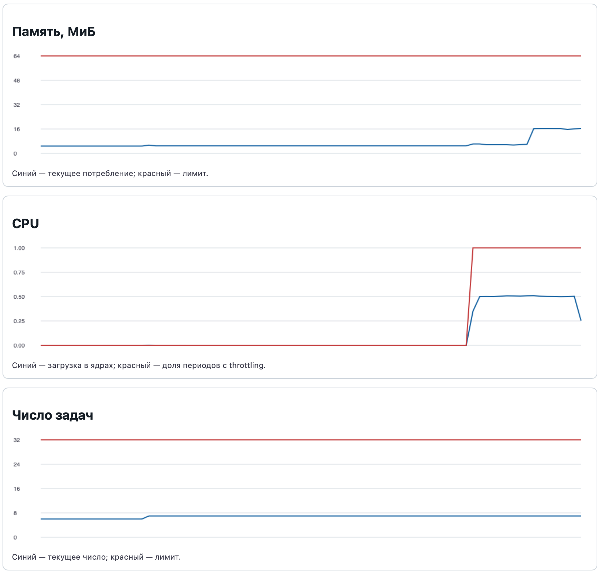

<em>Рисунок 32 — дашборд с потреблением памяти, нагрузкой CPU, throttling и количеством задач</em>

Во время `/burn` появились интервалы со 100% throttling.
В конце убил процесс выделив 120 метров памяти так что на графике не будет видно плавно подъема, перед этим выделил 10, на графике видно что потребление выросло.

Слежка за памятью нужна для того чтобы мы не уперлись в потолок и наш процесс не ушел в OOMKill от своей грустной жизни, за количеством процессов нужно следить чтобы видеть можем ли мы еще их насоздавать или нет, метрика CPU также важна, чтобы мы понимали когда наш сервис начинает тормозить и тротлить и предотвращать это своевременно и находить причину этого. 

---

# Вывод

Сначала я собрал свой мини докер, разобрался как работают утилиты используемые в технологиях контейнеризации, сравнил уже готовое решение в виде докера со своим, поработал с виртуализацией и построил дашборд с метриками
