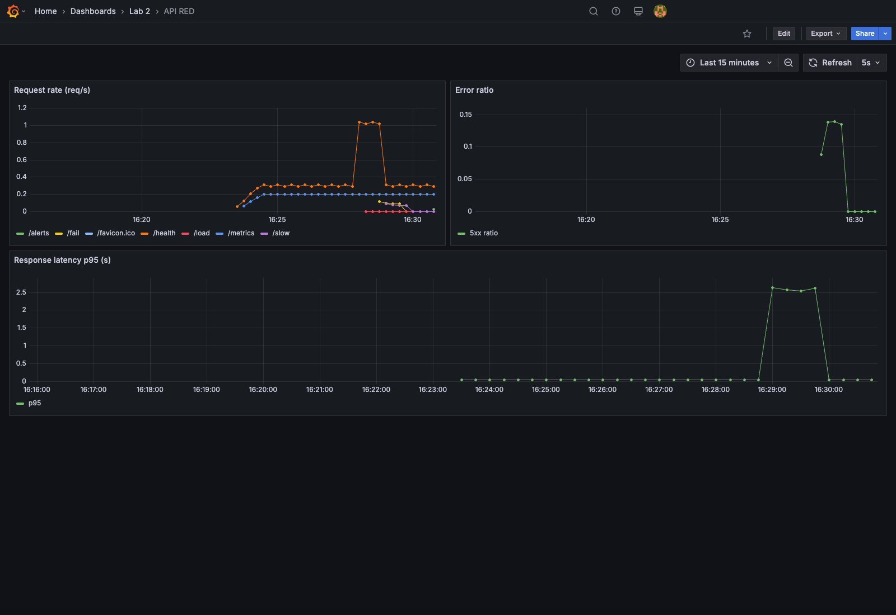
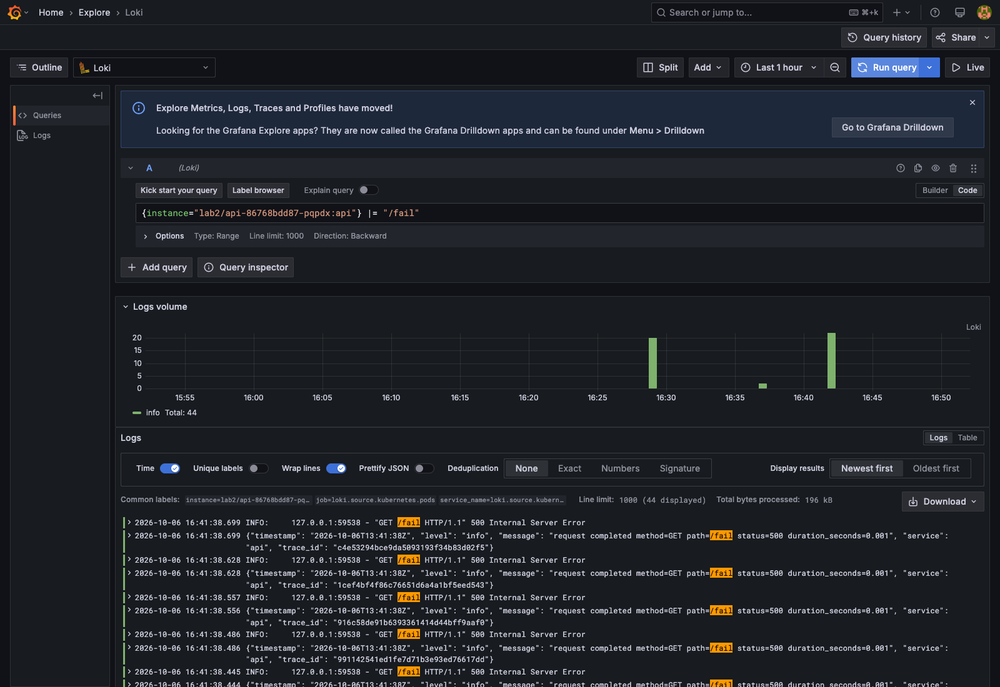
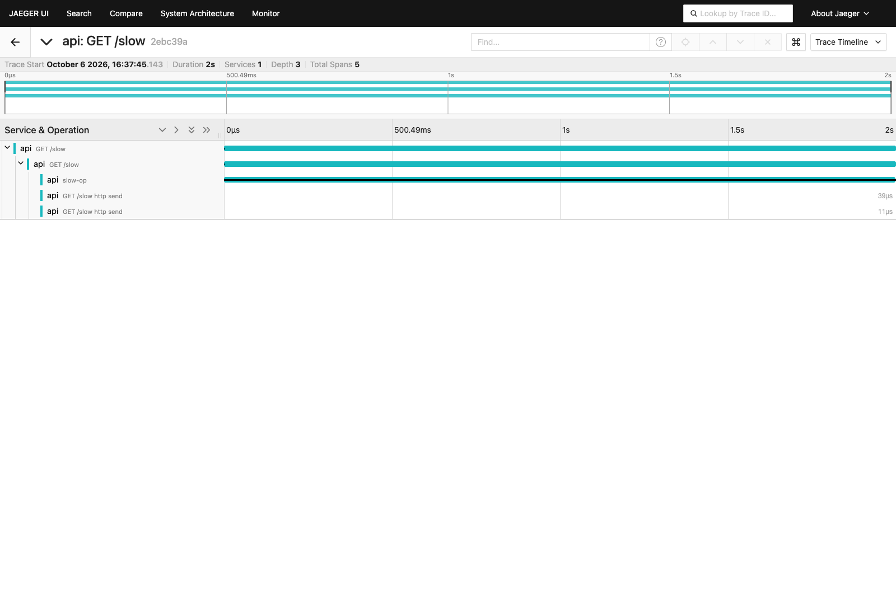
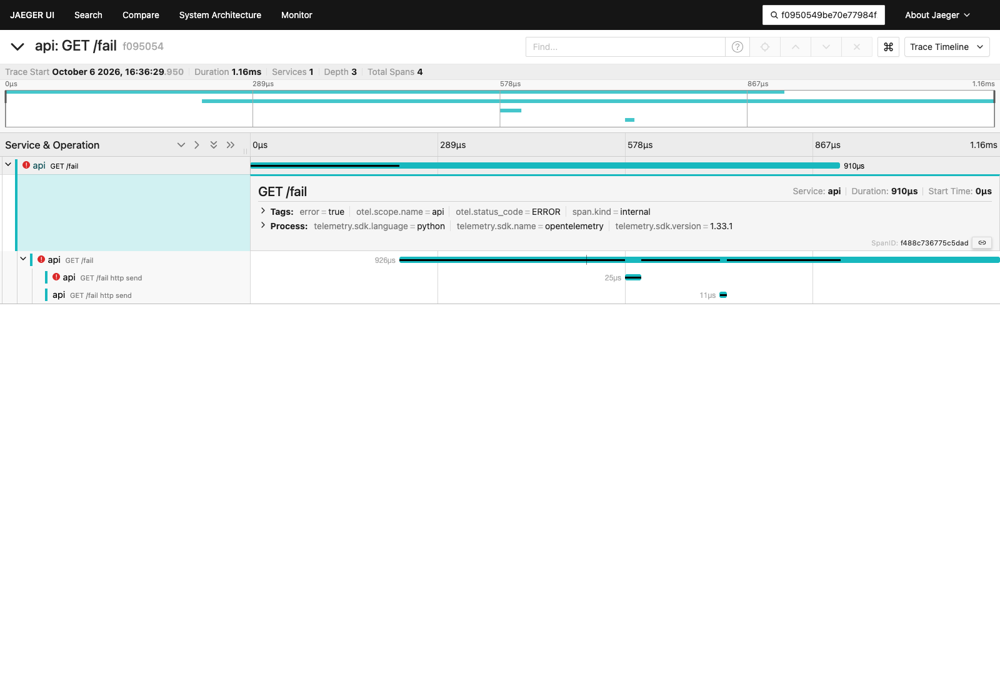
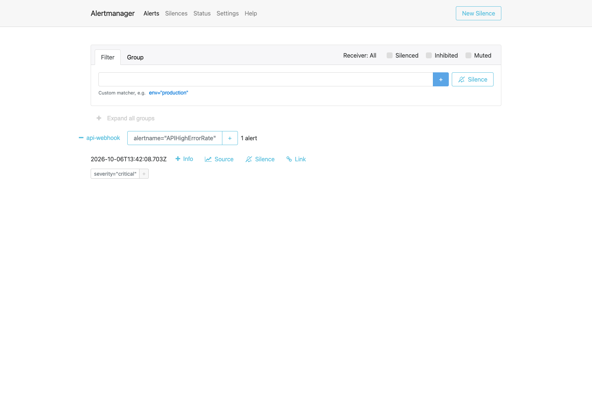
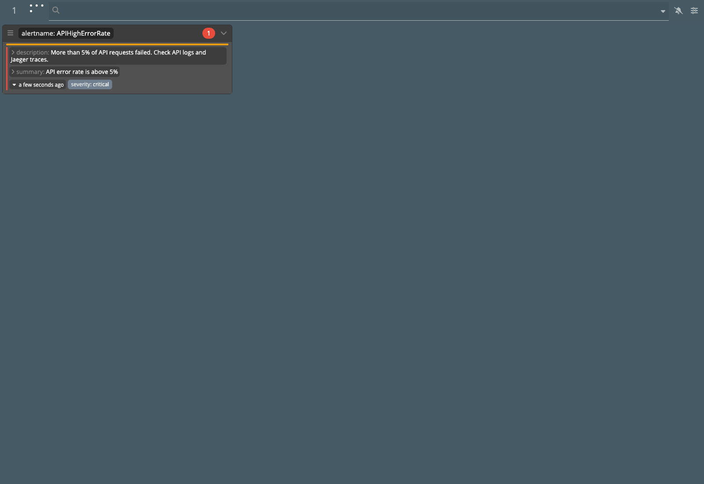
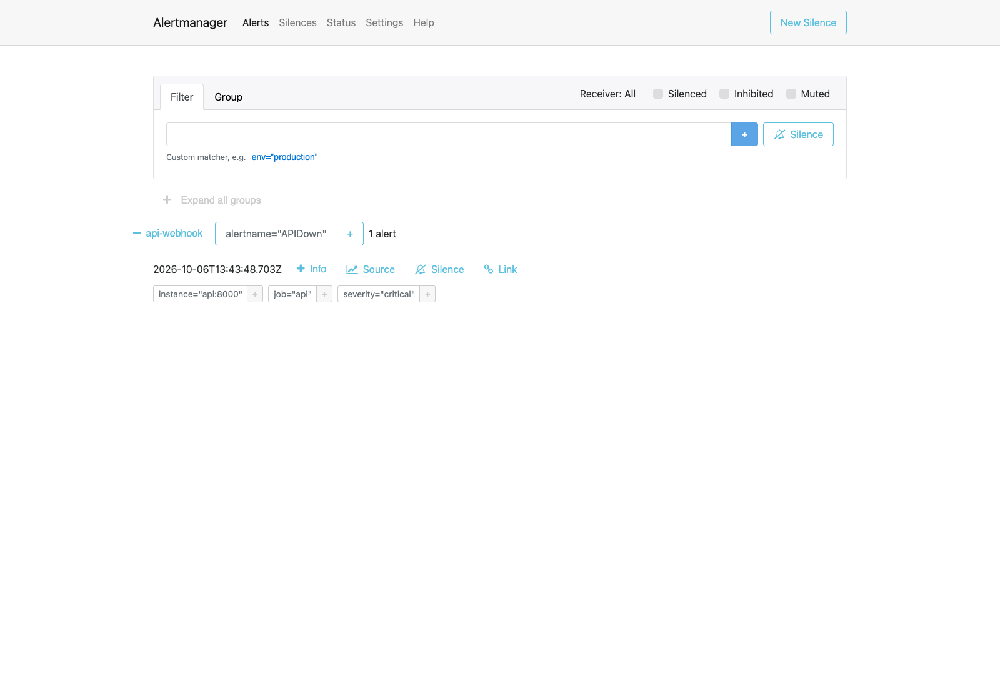
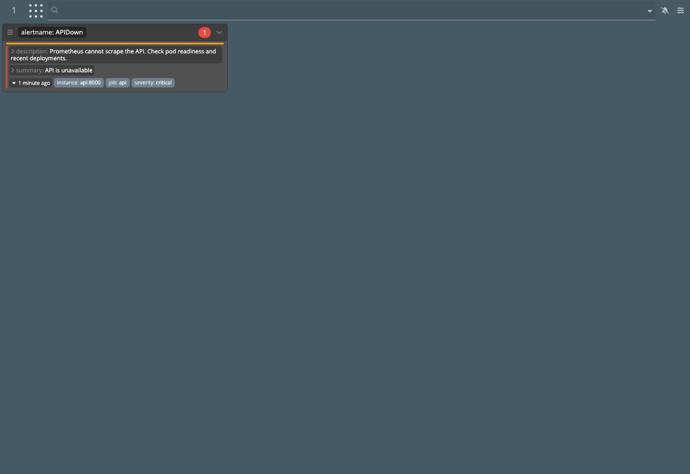

# Лабораторная работа 2. Мониторинг сервиса: метрики, логи, трейсы

## О чём лаба

Задача была собрать вокруг маленького HTTP-сервиса полноценную наблюдаемость: метрики, логи, трейсы и алерты, причём всё
в Kubernetes через Helm. Сам сервис тут вторичен, он нужен как «подопытный», которого можно ломать по кнопке. Важно было
другое: если сервису плохо, это должно быть видно сразу с трёх сторон. Метрика показывает, **что** случилось, лог
объясняет **почему**, а трейс показывает, **где** именно.

В итоге у нас получился такой стек (namespace `lab2`, локальный кластер kind из одной ноды):

| Сигнал  | Кто собирает и хранит                                                                  | Где смотреть                   |
|---------|----------------------------------------------------------------------------------------|--------------------------------|
| Метрики | Prometheus сам ходит на `api:8000/metrics` раз в 5 секунд (pull-модель)                | Grafana, дашборд `API RED`     |
| Логи    | Сервис пишет JSON в stdout, Alloy (DaemonSet) читает логи подов и отправляет их в Loki | Grafana Explore, источник Loki |
| Трейсы  | OpenTelemetry SDK в сервисе отправляет спаны по OTLP/HTTP                              | Jaeger (all-in-one)            |
| Алерты  | Prometheus проверяет правила на PromQL, Alertmanager рассылает webhook                 | Alertmanager и Karma           |

Весь стек мы ставили готовыми чартами из официальных репозиториев и только переопределяли нужное в values-файлах ([
`helm/values`](helm/values)). Свой маленький чарт написали только для сервиса ([`helm/api`](helm/api)).

| Компонент                | Чарт                              | Values                                                                                     |
|--------------------------|-----------------------------------|--------------------------------------------------------------------------------------------|
| Prometheus, Alertmanager | `prometheus-community/prometheus` | [`prometheus.yaml`](helm/values/prometheus.yaml): scrape сервиса, правила алертов, webhook |
| Grafana                  | `grafana-community/grafana`       | [`grafana.yaml`](helm/values/grafana.yaml): источники Prometheus и Loki, дашборд RED       |
| Loki                     | `grafana/loki`                    | [`loki.yaml`](helm/values/loki.yaml): режим SingleBinary, хранение на диске                |
| Alloy                    | `grafana/alloy`                   | [`alloy.yaml`](helm/values/alloy.yaml): сбор логов подов и отправка в Loki                 |
| Jaeger                   | `jaegertracing/jaeger`            | не понадобились, по умолчанию чарт и так ставит all-in-one с хранением в памяти            |
| Karma                    | `wiremind/karma`                  | [`karma.yaml`](helm/values/karma.yaml): адрес Alertmanager                                 |

## Сервис `api`

Это небольшое приложение на FastAPI ([`api/app.py`](api/app.py), [`api/Dockerfile`](api/Dockerfile)). Эндпоинты нужны,
чтобы самим провоцировать разные ситуации:

| Путь       | Что делает                                                              |
|------------|-------------------------------------------------------------------------|
| `/health`  | отвечает `ok`                                                           |
| `/fail`    | отдаёт 500 и помечает спан как ошибочный                                |
| `/slow`    | спит 2 секунды внутри отдельного вложенного спана `slow-op`             |
| `/load`    | делает 40 параллельных запросов к своему `/health`, чтобы подскочил RPS |
| `/metrics` | метрики для Prometheus                                                  |
| `/alerts`  | принимает webhook от Alertmanager и пишет его в лог                     |

Что сделано в сервисе для наблюдаемости:

- **Метрики RED.** Через `prometheus_client` сервис отдаёт счётчик `http_requests_total` (с метками `method`, `path`,
  `status`), счётчик ошибок `http_errors_total` и гистограмму `http_request_duration_seconds`. Из них получаются все три
  показателя RED: Rate, Errors, Duration.
- **Структурированные логи.** Каждая строка лога это JSON с полями `level`, `message`, `service` и `trace_id`. Пишем
  в stdout, а не в файл, потому что файловая система контейнера эфемерна. Stdout забирает рантайм ноды, а оттуда его уже
  читает агент.
- **Трейсы.** `FastAPIInstrumentor` сам создаёт корневой спан на каждый запрос. В `/slow` и `/fail` мы руками добавили
  то, чего автоматика не знает: вложенный спан `slow-op` и статус `ERROR`. Адрес Jaeger передаётся через переменную
  `OTEL_EXPORTER_OTLP_ENDPOINT`.

Самое важное здесь то, что `trace_id` текущего спана попадает в каждую строку лога. Именно так логи и трейсы связываются
между собой: находим подозрительную строку в Loki и по её `trace_id` открываем весь запрос в Jaeger.

## Часть 1. Метрики

Prometheus скрейпит `/metrics` сервиса, Grafana подключена к нему как к источнику данных. Дашборд `API RED` состоит из
трёх панелей:

- **Request rate**: `sum by (path) (rate(http_requests_total[1m]))`, то есть RPS отдельно по каждому эндпоинту;
- **Error ratio**: доля ответов 5xx от всех запросов;
- **Response latency p95**: `histogram_quantile(0.95, ...)` по гистограмме времени ответа.

`rate()` нужен потому, что счётчики только растут, и число «всего было N запросов» само по себе ни о чём не говорит.
Интересна именно скорость.

Мы понажимали `/load`, `/fail` и `/slow`, и графики отреагировали как ожидалось. При `/load` RPS по `/health` вырос
примерно в три раза, во время серии `/fail` доля ошибок поднялась примерно до 14%, а во время `/slow` p95 вырос почти
с нуля до 2,5 секунд.



## Часть 2. Логи

Сначала нужно было разобраться с ролями. Loki это только хранилище, сам он логи ниоткуда не забирает. Собирает их
отдельный агент, мы взяли Grafana Alloy. Его чарт по умолчанию разворачивается как **DaemonSet**, то есть на каждой ноде
работает ровно один экземпляр. Alloy через API Kubernetes находит поды, читает их вывод и отправляет в Loki. Loki мы
добавили в ту же Grafana, поэтому метрики и логи смотрятся в одном окне.

Дёрнули `/fail` и нашли ошибку таким запросом:

```logql
{instance="lab2/api-86768bdd87-pqpdx:api"} |= "/fail"
```

В выдаче видны JSON-строки со `status=500` и `trace_id` каждого запроса:



## Часть 3. Трейсы

Jaeger поднят в режиме all-in-one, он сразу принимает OTLP. В Jaeger UI мы выбрали сервис `api` и нашли два нужных
трейса.

**`/slow`.** В водопаде сразу видно, что почти все 2 секунды запроса ушли во вложенный спан `slow-op`. Ради этого
трейсинг и нужен: по метрикам понятно только, что «где-то медленно», а здесь видно, где именно.



**`/fail`.** Спан помечен как ошибочный (`otel.status_code = ERROR`, `error = true`), и Jaeger подсвечивает его
красным. Этот трейс мы открыли так, как и задумано в лабе: взяли `trace_id` из строки лога в Grafana
(`f0950549be70e77984f2da6c54f22c6f`) и вставили его в поиск Jaeger.



## Часть 4. Алерты

Правила описаны в Prometheus на PromQL. Сработавшие алерты уходят в Alertmanager, он группирует их по имени и отправляет
webhook. Получателем мы сделали сам сервис (`/alerts`): он пишет пришедший алерт в лог, так что срабатывание видно ещё
и в Loki. Поверх Alertmanager поднята Karma, это дашборд со всеми активными алертами.

Алерты мы старались выбирать по **симптомам**, то есть по тому, что реально чувствует пользователь, а не по внутренним
причинам вроде «CPU 90%». У всех трёх стоит `severity: critical`, по ним нужно реагировать сразу.

| Алерт               | Условие                          | Что ловит и почему важно                                                                                   | Что делать дежурному                                                                                               |
|---------------------|----------------------------------|------------------------------------------------------------------------------------------------------------|--------------------------------------------------------------------------------------------------------------------|
| `APIHighErrorRate`  | доля 5xx > 5% дольше 30 с        | Пользователи массово получают ошибки, для части запросов сервис фактически не работает                     | Открыть логи `api` в Loki, по `trace_id` найти упавшие запросы в Jaeger. Если совпало с релизом, откатить          |
| `APIHighP95Latency` | p95 > 1 с дольше 30 с            | Каждый двадцатый запрос идёт дольше секунды: пользователи ждут, клиенты начинают отваливаться по таймаутам | Найти медленные трейсы в Jaeger и посмотреть, какой спан тормозит. Проверить ресурсы пода и зависимости            |
| `APIDown`           | `up{job="api"} == 0` дольше 30 с | Prometheus не может достучаться до сервиса, для пользователей он недоступен целиком                        | `kubectl describe pod` и события кластера (OOMKilled, CrashLoopBackOff, не тянется образ), логи последнего запуска |

30 секунд это учебный порог, чтобы алерты срабатывали быстро. На деле алерт загорается чуть позже, примерно через
1-2 минуты, потому что Prometheus по умолчанию проверяет правила раз в минуту. На реальном проекте мы бы поставили
несколько минут, чтобы короткие всплески не будили дежурного зря.

Как проверяли: серия `/fail` вызывает `APIHighErrorRate`, долгая серия `/slow` вызывает `APIHighP95Latency`. Для
`APIDown` мы отмасштабировали деплоймент до нуля реплик (`kubectl -n lab2 scale deployment/api --replicas=0`), а потом
вернули обратно. Все три алерта перешли в состояние firing и появились и в Alertmanager, и в Karma.

**APIHighErrorRate**




**APIHighP95Latency**


**APIDown**




## Как запустить

```bash
kind create cluster --name lab2 --config kind.yaml
docker build -t lab2-api:dev api
kind load docker-image lab2-api:dev --name lab2

helm repo add prometheus-community https://prometheus-community.github.io/helm-charts
helm repo add grafana https://grafana.github.io/helm-charts
helm repo add grafana-community https://grafana-community.github.io/helm-charts
helm repo add jaegertracing https://jaegertracing.github.io/helm-charts
helm repo add wiremind https://wiremind.github.io/wiremind-helm-charts
helm repo update

kubectl create namespace lab2
helm install prometheus prometheus-community/prometheus -n lab2 -f helm/values/prometheus.yaml
helm install loki grafana/loki -n lab2 -f helm/values/loki.yaml
helm install alloy grafana/alloy -n lab2 -f helm/values/alloy.yaml
helm install grafana grafana-community/grafana -n lab2 -f helm/values/grafana.yaml
helm install jaeger jaegertracing/jaeger -n lab2
helm install karma wiremind/karma -n lab2 -f helm/values/karma.yaml
helm install api helm/api -n lab2
```

Интерфейсы открываются через `kubectl port-forward`:

```bash
kubectl -n lab2 port-forward svc/grafana 3000:80                    # admin / lab2admin
kubectl -n lab2 port-forward svc/jaeger 16686:16686
kubectl -n lab2 port-forward svc/prometheus-server 9090:80
kubectl -n lab2 port-forward svc/prometheus-alertmanager 9093:9093
kubectl -n lab2 port-forward svc/karma 8080:80
kubectl -n lab2 port-forward svc/api 8000:8000
```

## Вывод

Главное, что мы вынесли из лабы: по отдельности три сигнала дают мало, а вместе получается почти готовый диагноз. На
примере `/fail` это хорошо видно. Дашборд показал, что выросла доля ошибок, в Loki нашлась конкретная строка с 500-й
ошибкой, а по её `trace_id` в Jaeger открылся сам запрос с красным спаном. С `/slow` так же: метрика говорит только, что
p95 вырос, а водопад в Jaeger сразу показывает, что всё время съел `slow-op`.

Ещё мы поняли пару практических вещей. Во-первых, связь логов и трейсов сама не появляется, её нужно заложить в код и
проставлять `trace_id` в каждый лог. Во-вторых, алерты легко сделать бесполезными: если будить человека по каждой
причинной метрике, на них просто перестанут реагировать. Поэтому все три наших алерта про то, что чувствует
пользователь: ошибки, медленные ответы и полная недоступность. Этот стек можно переиспользовать в следующих лабах,
достаточно добавить новые сервисы в scrape-конфиг Prometheus.
