# Лаба 3 — платформа для shop

## Часть 0 — сервисы

`api` и `worker` на Go ([`app/`](app)), один Dockerfile на оба.

`api` поднимает HTTP сразу и к базе подключается в фоне — иначе в Части 2 (базы еще нет) пробы бы не проходили и все стояло бы.

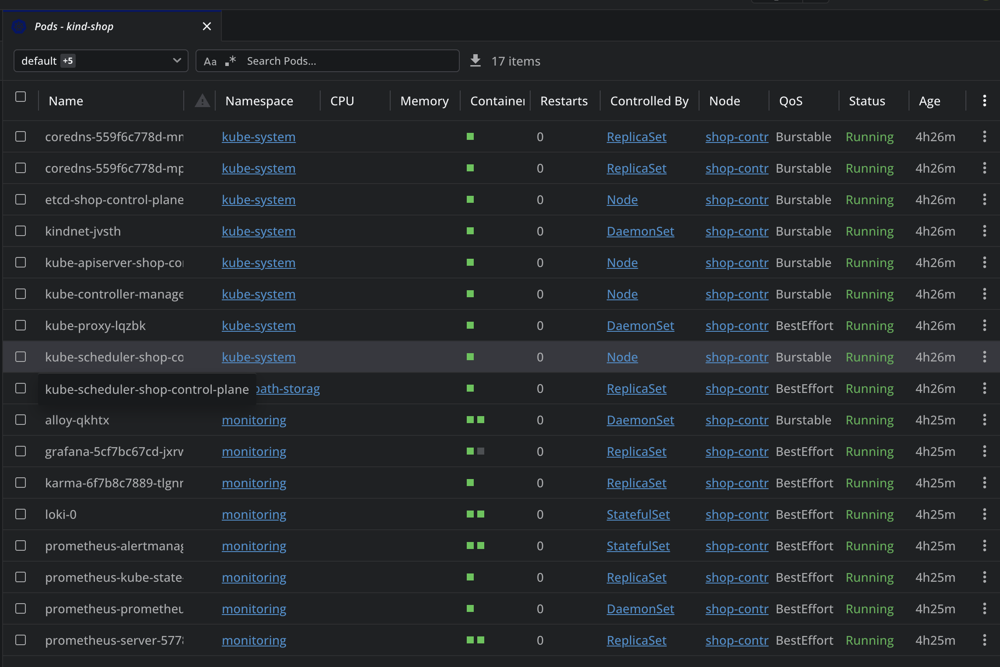
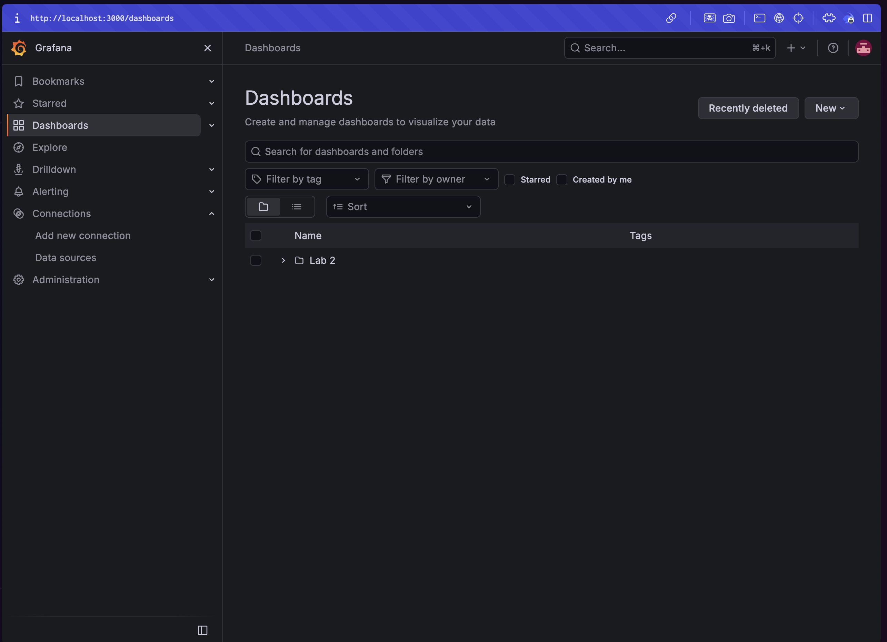

## Часть 1 — ограждения

Взял **Kyverno**: правила — обычные манифесты, Rego учить не надо. Kyverno заточен чисто под кубер, а Gatekeeper — обертка над OPA, у которого Rego окупается, когда политики нужны еще и вне кластера. Нам не нужны.

Kyverno 1.19 уже ругается на старый `ClusterPolicy`, поэтому политики на новом `ValidatingPolicy` с CEL ([`policies/`](policies)). Пишутся на `pods`, autogen сам раскатывает их на Deployment/StatefulSet/Job.

- `require-resources` — requests cpu/memory и limit memory. Без requests шедулер размещает вслепую, без limit один под съест ноду. CPU limit сознательно не требую — троттлинг
- `restrict-image-registries` — образы только из `registry.shop.local/` и `ghcr.io/cloudnative-pg/`, никаких случайных образов из Docker Hub
- `require-labels` — метки `app.kubernetes.io/name` и `part-of`, по ним селекторы, мониторинг и поиск «чье это»
- `disallow-privileged` — запрет `privileged: true`, потому что privileged = root на ноде
- `disallow-latest-tag` (свое) — явный тег, не `latest`: с `latest` непонятно что запущено и rollback бесполезен

Исключены системные namespace-ы (`kube-system`, `kyverno`, `monitoring`, `local-path-storage`, `cnpg-system`) — иначе ломаются чужие чарты. Понимаю, что исключенный namespace = дыра: кто может создавать там поды, тот обходит все. Правильнее исключать по identity запроса или хотя бы не снимать `disallow-privileged`, но для лабы так.

Нарушители — [`bad-manifests/`](bad-manifests): эталон `00-good` проходит, остальные пять ломают по одному полю и отклоняются.

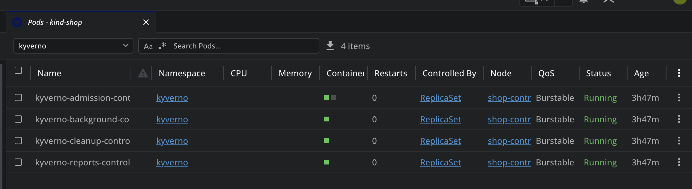
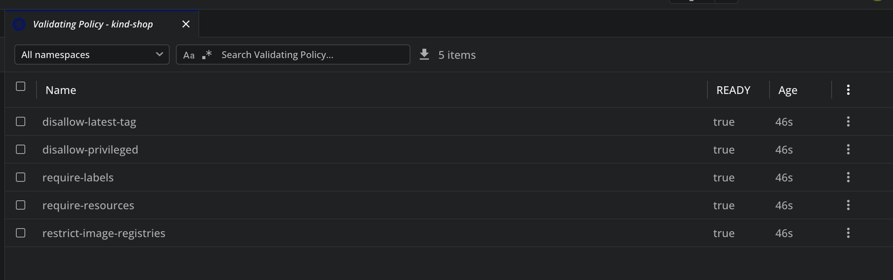
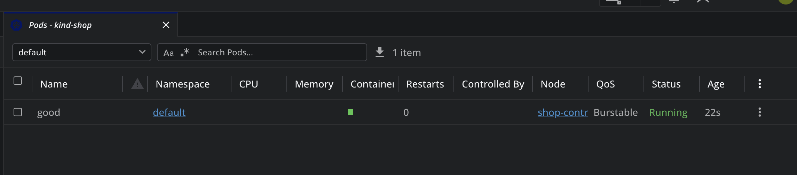
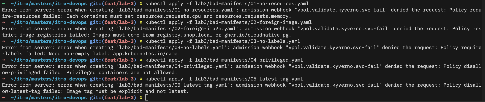

## Часть 2 — чарт api и worker

[`charts/shop/`](charts/shop): api 3 реплики, worker 2, пробы на `/health`, все под политики сразу (ресурсы, реестр, теги, метки). В selector только `name` + `instance`.

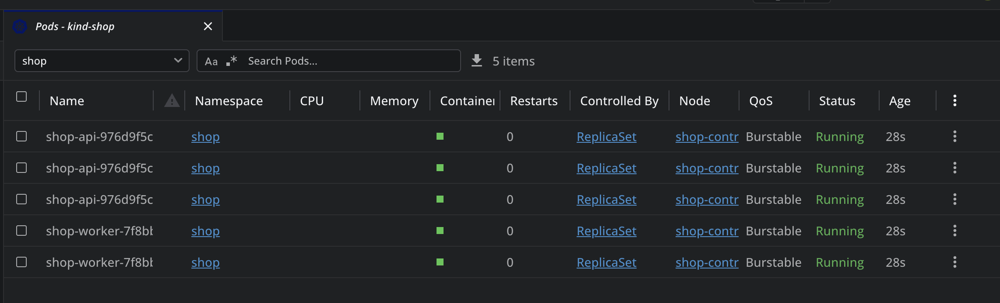
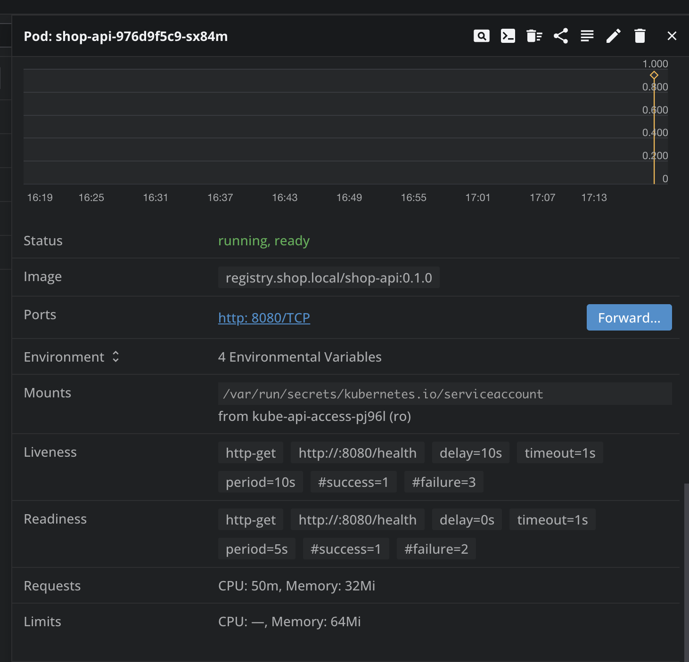

**Reconciliation.** Удалил под api — через секунду новый (с другим именем и IP). `replicas` 3 → 4 + `helm upgrade` — подов стало 4.

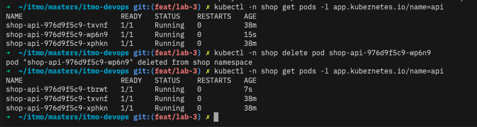
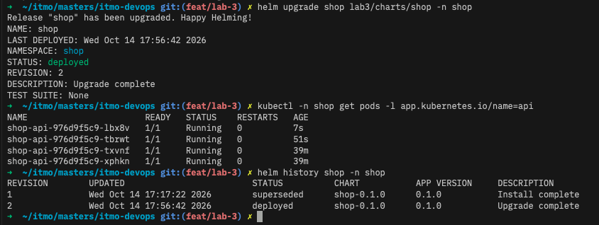

**Rolling update.** `maxSurge: 1`, `maxUnavailable: 0`, долбил `/health` в цикле. Первый заход на 0.2.0 — не все 200. Вероятно, причина в том, что SIGTERM поду и обновление iptables у kube-proxy идут параллельно, api успевал закрыть порт раньше, чем его убирали из endpoints. Добавил `preStop: sleep 5` — на 0.3.0 уже все 200.

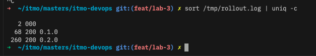
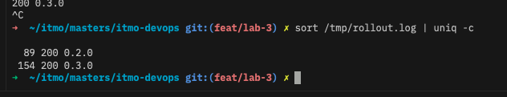

**Сломанная версия.** `HEALTH_FAIL=true` → новый под не проходит readiness, rollout висит, старые 4 пода живы (`maxUnavailable: 0`). За это время все запросы 200. `helm rollback` — кластер вернулся.

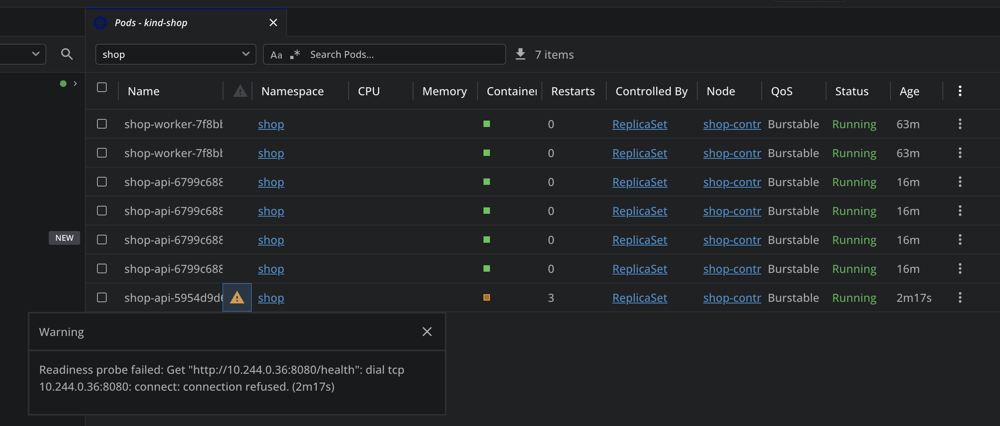
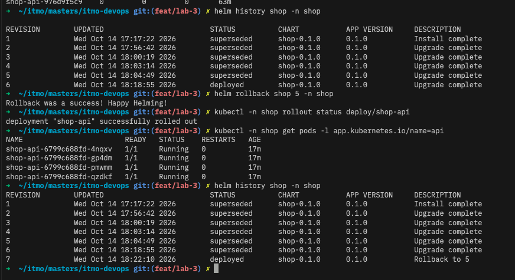

## Часть 3 — postgres через оператора

CloudNativePG, ставится один раз на кластер, в чарте — объект `Cluster` ([`postgres-cluster.yaml`](charts/shop/templates/postgres-cluster.yaml)). Под политики он проходит через свой spec: `imageName` с тегом, `resources`, метки через `inheritedMetadata`. Пароль никто не пишет — оператор сам создает Secret `shop-db-app` с `uri`, api/worker берут его через `secretKeyRef`.

Удалил `shop-db-1` — оператор вернул под **с тем же именем** и тем же PVC, данные на месте. Правда, удаление висело ~3 минуты в Terminating: оператор делает smart shutdown и ждет, пока клиенты отключатся, а пулы соединений api/worker отключаться не собирались.

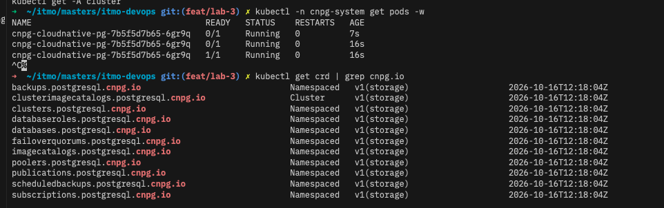
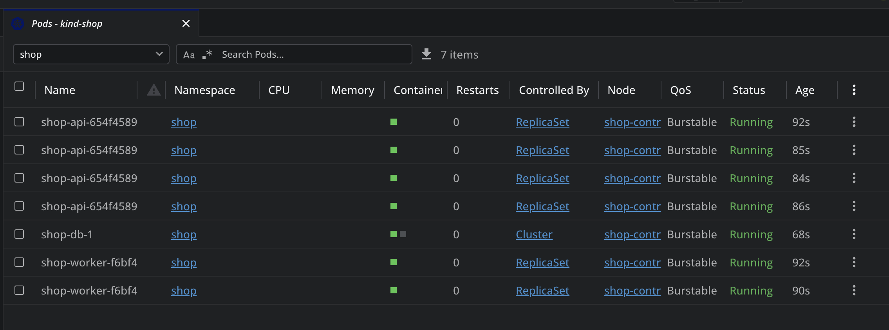
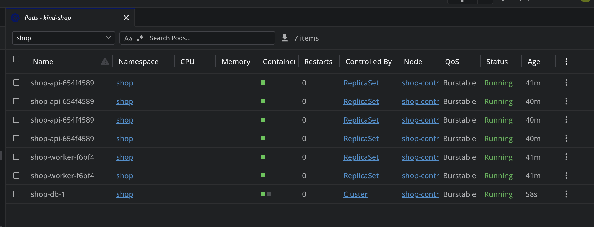

`spec` и `status` объекта — [`pg-cluster-config.yaml`](pg-cluster-config.yaml). `spec` пишу я (instances, image, storage), `status` пишет оператор (`phase: Cluster in healthy state`, `currentPrimary`, `readyInstances`). Если руками поправить status через обычный edit — apiserver выкинет правку (status-подресурс), а если через `/status` — оператор перезапишет на ближайшей сверке.

**Оператор vs controller-manager.** Механизм тот же: watch - сравнить желаемое с фактическим - исправить. Разница в знании предметки. ReplicaSet держит N одинаковых взаимозаменяемых подов со случайными именами. Оператор знает, что под — это база: у инстанса стабильное имя и свой PVC, есть primary/реплики и failover, пароль надо сгенерировать и положить в Secret, перед остановкой — checkpoint и аккуратный shutdown. controller-manager такого не умеет и не должен.

## Часть 4 — падение control plane

Убрал манифест etcd из `/etc/kubernetes/manifests` — kubelet остановил static pod.

- `kubectl get`, `kubectl apply`, `helm upgrade` — ошибки;
- api отвечал, заказы создавались и обрабатывались worker-ом.

Почему: правила NodePort уже лежат в iptables ноды, контейнеры держит kubelet, DNS у CoreDNS в кеше, соединения к postgres открыты. Удаленный под никто бы не вернул: ReplicaSet-контроллеру нужен apiserver.

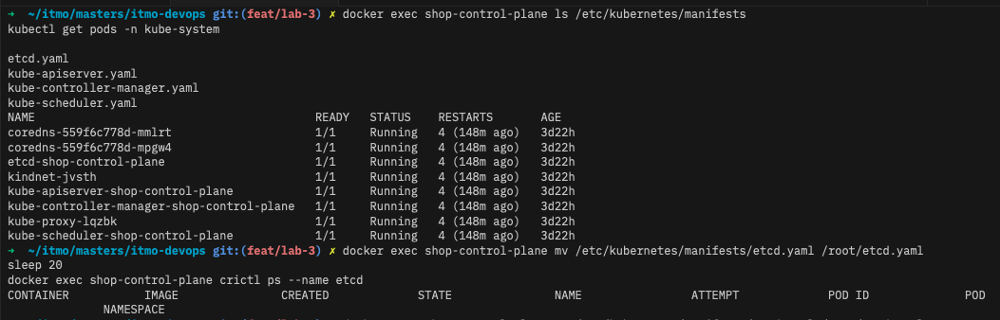
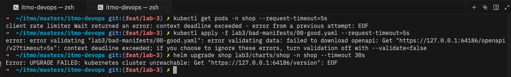
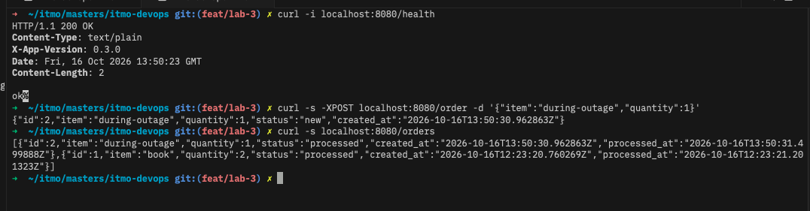

После возвращение манифеста кластер управляем не сразу. apiserver успел перезапуститься 9 раз, controller-manager и scheduler сами завершились, а оператор CNPG ушел в CrashLoopBackOff. Первый `helm upgrade` упал. Спустя некоторое время после прохождения таймаута, все восстановилось.

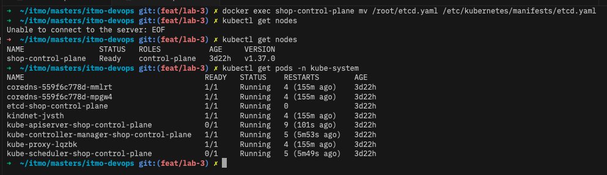
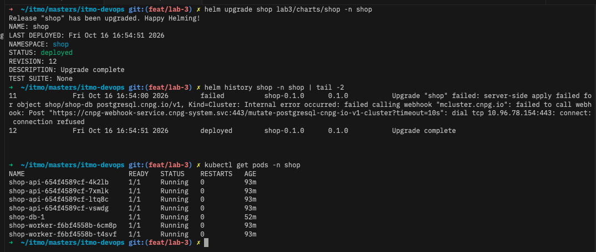

## Часть 5 — мониторинг

Во второй лабе Prometheus стоял без оператора, а `ServiceMonitor`/`PrometheusRule` — это его API. Сначала пытался сделать заплатку, потом решил перевести стек на `kube-prometheus-stack` целиком ([`../monitoring`](../monitoring/README.md)) — он еще понадобится в лабах 4–5. Loki/Alloy/Karma те же. Бонусом ушел static config на адрес Service, который с 4 репликами скрейпил бы случайный под.

В чарте:
- [`service-monitor.yaml`](charts/shop/templates/service-monitor.yaml) — один на api и worker, Prometheus скрейпит каждый под отдельно;
- [`prometheus-rule.yaml`](charts/shop/templates/prometheus-rule.yaml) — 3 алерта;
- [`grafana-dashboard.yaml`](charts/shop/templates/grafana-dashboard.yaml) + [`dashboards/shop.json`](charts/shop/dashboards/shop.json) — дашборд. JSON отдельным файлом, потому что Helm пытается выполнить `{{route}}` из легенд Grafana (и упал на нем даже в комментарии).

- `ShopApiDown` — нет ни одного живого пода api (`for: 1m`). Значит заказы не принимаются. `absent()` нужен, потому что при 0 подах метрики `up` нет вообще и `== 0` ничего не найдет
- `ShopApiRolloutStuck` — `kube_deployment_status_replicas_unavailable > 0` (`for: 2m`). Зависший релиз: пользователь пока не страдает, но пора откатывать
- `ShopOrdersNotProcessed` — worker больше минуты без успешного цикла. api зеленый, а заказы копятся — по `up` такое не увидеть

Спровоцировал `ShopApiRolloutStuck` тем же `HEALTH_FAIL=true`: Pending → через 2 минуты Firing → в Alertmanager. Откатил — ушел.

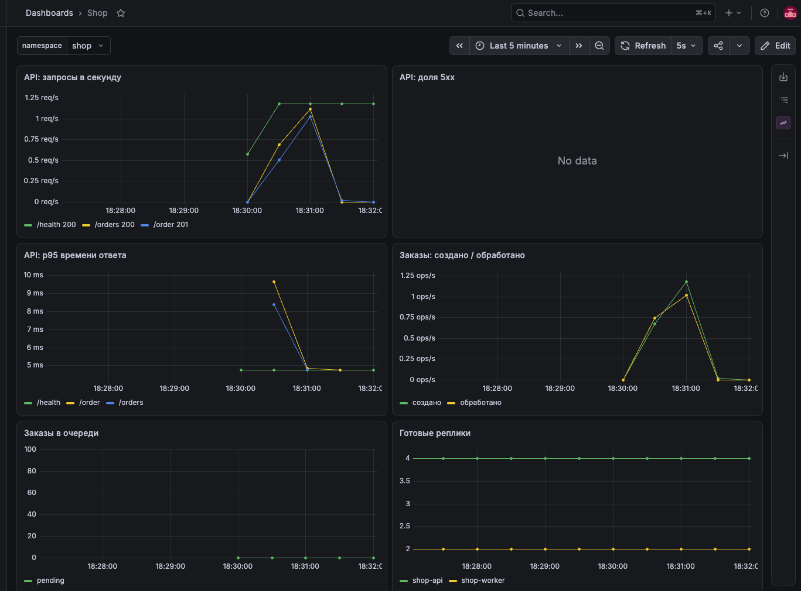
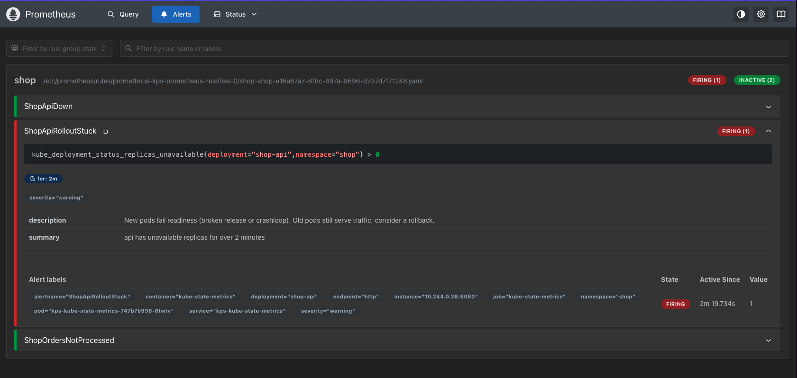
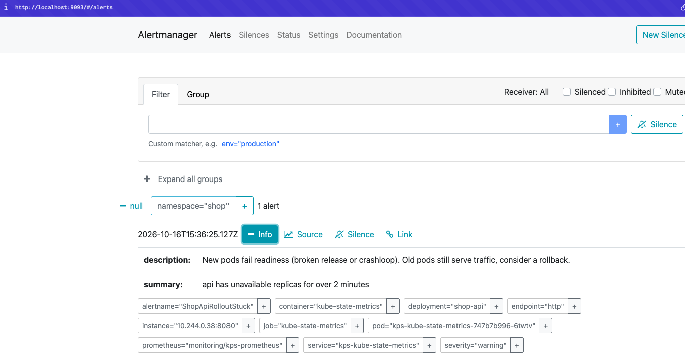
