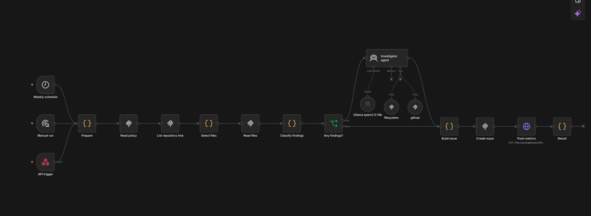
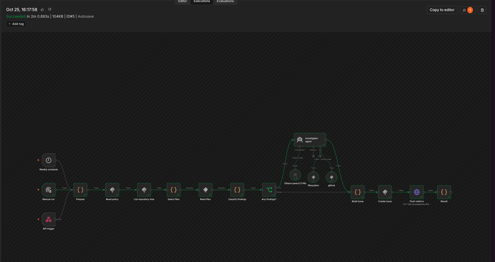
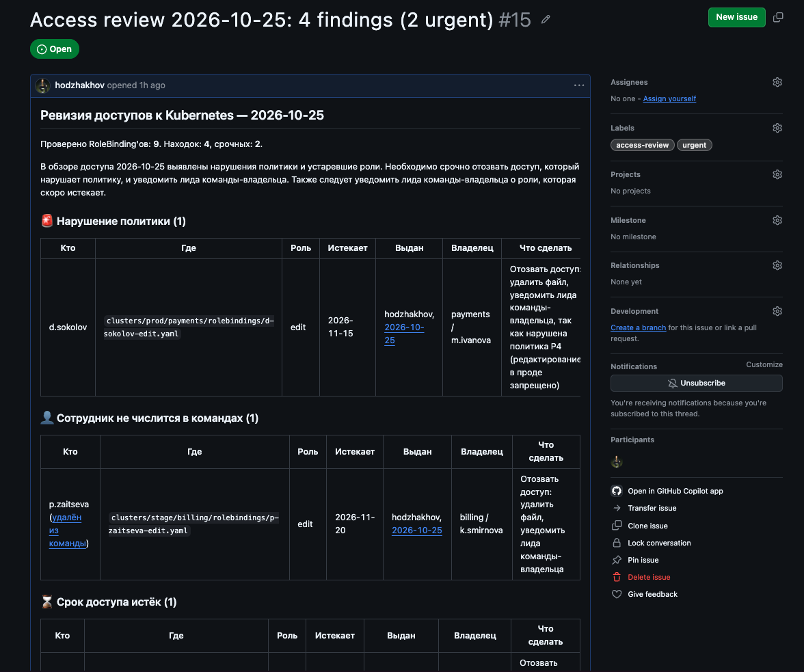
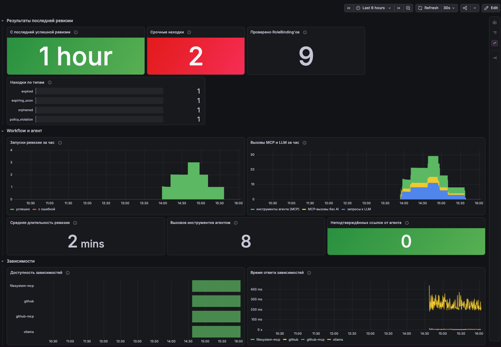
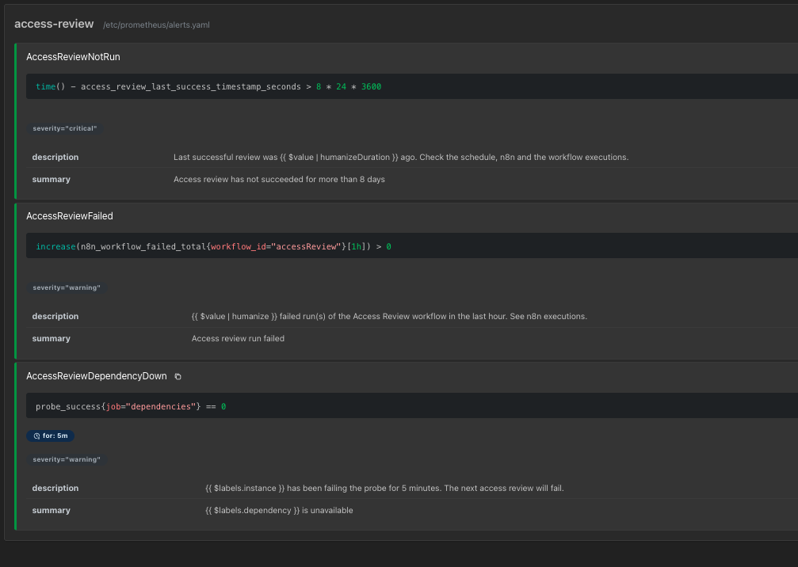

# Лаба 8

## 1. Кейс

Company - финтех, платежный шлюз для малого бизнеса, работает 100 сотрудников. Есть несколько продуктовых команд (payments, billing, risk, qa). Инфра в Кубере, есть stage и prod, у каждой команды свой namespace.  

Доступы описаны в репе infra-rbac: есть манифесты с выданными доступами, составы команд и CODEOWNERS. Также есть политики доступа.  

Воркфлоу раз в неделю по расписанию запускается и выполняет следующее:
1. читает политику
2. обходит все манифесты
3. находит 4 вида проблем: нарушение политик, доступы ушедших сотрудников, просроченные доступы и доступы, которые скоро истекут.
4. агент анализирует каждую проблему

В результате открывается Issue в репозитории инфры.

Такая автоматизация поможет не пропустить какие-то забытые доступы, либо ошибочно выданные доступы, которые нарушают политики.

Избавляет девопс-инженеров от ручной работы, лиды команд сразу видят какие доступы скоро заканчиваются + есть история всех таких анализов.

## 2. Реализация

Хотелось сделать все локально и бесплатно, поэтому в качестве LLM был выбран qwen через Ollama.
Сначала взял qwen2.5 7b, но она путала правила и зацикливалась, по нескольку раз запрашивая один и тот же файл.
В итоге остановился на qwen2.5 14b. Отдельно пришлось поднять контекст - по умолчанию у Ollama 4096 токенов, а у ноды Ollama в n8n вообще 2048, и skill туда просто не влезал.

Воркфлоу в n8n:

**Триггер** - расписание, каждый понедельник в 09:00. Дополнительно можно запустить руками из n8n или через вебхук.

**Шаги**:
1. Prepare - определяет дату, репозиторий и источник запуска.
2. Read policy - читает политику через filesystem MCP и берет из нее порог «скоро истекает».
3. List repository tree - одним вызовом `get_repository_tree` получает список всех файлов в `clusters/`.
4. Select files + Read files - читает `teams.yaml` и каждый RoleBinding через `get_file_contents`.
5. Classify findings - применяет правила: сравнивает даты, роли и состав команд, формирует список проблем.
6. Investigator agent - по скилу `access-review` расследует каждую проблему: история коммитов, владелец, лид, рекомендация, резюме.
7. Build issue - объединяет проблемы и расследование, удаляет неподтвержденные ссылки на коммиты, собирает markdown.
8. Create issue - создает issue через `issue_write` GitHub MCP.
9. Push metrics - отправляет результаты запуска в Pushgateway для мониторинга.
10. Result - для запуска через API возвращает ссылку на issue и сводку.

AI используется только на шаге 6, все остальное - обычный код и прямые вызовы MCP без модели.

**MCP-серверы** - Github MCP (содержимое файлов, история коммитов, создание issue), filesystem MCP (чтение политик доступов).

**Toolkit** агента:
Агенту доступны 3 инструмента, все только на чтение:
1. `filesystem_read_text_file` (`path`): читает политику доступов - правила и что делать с каждым типом проблем
2. `github_get_file_contents` (`owner`, `repo`, `path`): читает `CODEOWNERS` и `teams.yaml`
3. `github_list_commits` (`owner`, `repo`, `path`, `fields`): история коммитов по файлу - кто и когда выдал доступ, когда сотрудника удалили из команды

[`Skill`](skills/access-review/SKILL.md) описывает порядок расследования (политика, владельцы, история каждого файла, история `teams.yaml` для ушедших), правила (использовать только то, что вернули инструменты, не выдумывать ссылки и даты, не писать e-mail) и формат ответа в JSON.

n8n, MCP-сервера и мониторинг подняты в [docker-compose](./docker-compose.yaml). Обернул оба MCP в supergateway, чтобы подружить их с n8n (оба сервера работают через stdio, а n8n подключается по HTTP).

В изначальной версии агент сам читал все файлы, искал проблемы и возвращал списком. При тесте отработало, но нашлось только 2 из 4 проблем, причем пропустил самые срочные проблемы - edit в прод и ушедшего сотрудника. Заставил разбирать каждый файл отдельно - начал путаться в датах.

В итоге поменял так, чтобы все, что проверяется правилами (даты, роли), проверялось кодом, а агенту остается то, где нужно разбираться и формулировать (история коммитов, рекомендации к решению проблем).

После запуска workflow отработал за 2 минуты, почти все время занимает агент.

Был получен issue со всеми четырьмя проблемами. Для каждой агент нашел коммит, которым выдали доступ,  
владельца namespace и его лида, а для уволившегося сотрудника - коммит, где его убрали из команды.

**Запуск**

1. Запустить Ollama с контекстом 16k и скачать модель: `OLLAMA_CONTEXT_LENGTH=16384 ollama serve`, `ollama pull qwen2.5:14b`
2. Создать репозиторий `infra-rbac` и залить туда `mock/infra-rbac`
3. Создать токен на этот репозиторий (Contents - Read, Issues - Read and write) и положить в `.env`: `GITHUB_PAT=...`
4. `docker compose up -d --build`
5. В n8n импортировать [workflow.json](./workflow.json), добавить credential Ollama с адресом `http://host.docker.internal:11434`, опубликовать workflow
6. Запустить: кнопка Execute workflow. Результат - новый issue в `infra-rbac` с меткой `access-review`

## 3. Мониторинг
n8n отдает метрики сам, для Ollama и MCP-серверов развернул blackbox_exporter, также добавил Pushgateway для сбора статы из прогона.

На дашборде:
1. результаты последнего запуска - сколько прошло с последнего успешного прогона, срочные проблемы, сколько манифестов проверено, проблемы по типам
2. воркфлоу и агент - успешные и упавшие запуски, вызовы MCP и LLM, средняя длительность, неподтвержденные ссылки от агента (по сути, счетчик галлюцинаций)
3. зависимости - доступность и время ответа Ollama, обоих MCP-серверов и GitHub

**Алерты**

Выбрал три метрики, правила лежат в [prometheus/alerts.yaml](./prometheus/alerts.yaml):

1. Воркфлоу не прогонялся больше 8 дней - ловит тихие поломки: не сработало расписание, n8n лежал в понедельник, воркфлоу выключили
2. Запуск воркфлоу упал - чтобы узнать о проблеме сразу и перезапустить в тот же день
3. Зависимость недоступна (Ollama, MCP-сервер или GitHub дольше 5 минут) - следующий запуск точно упадет, лучше узнать заранее

